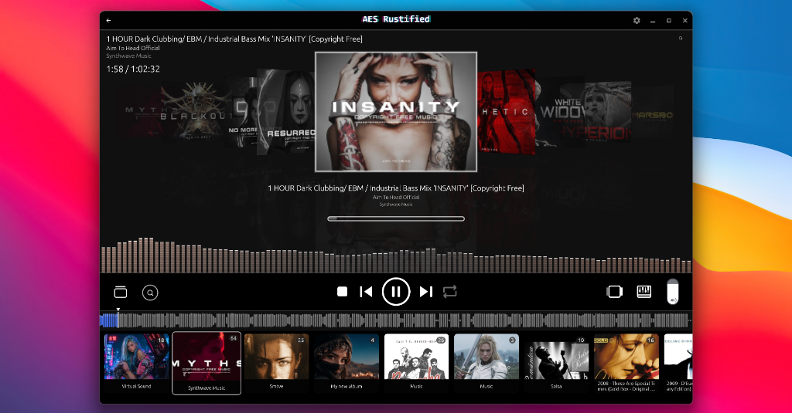
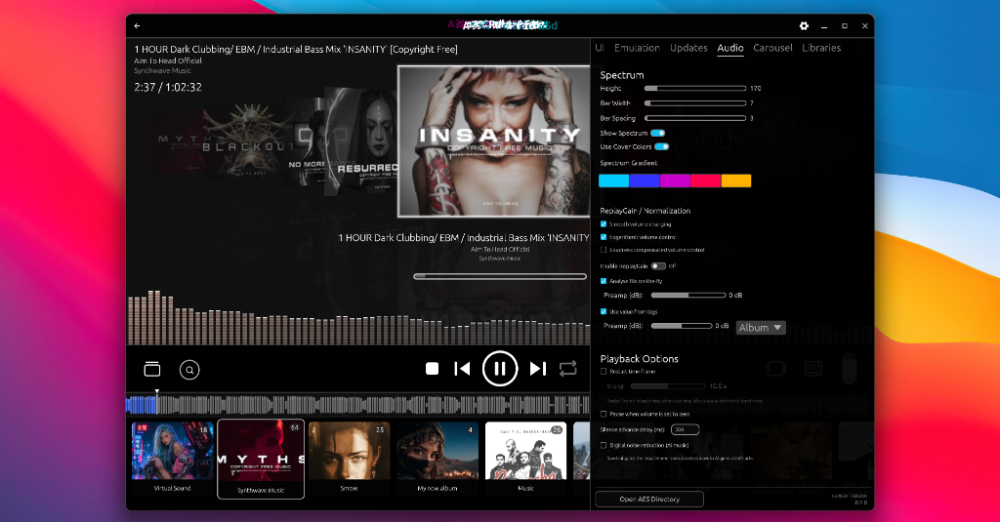
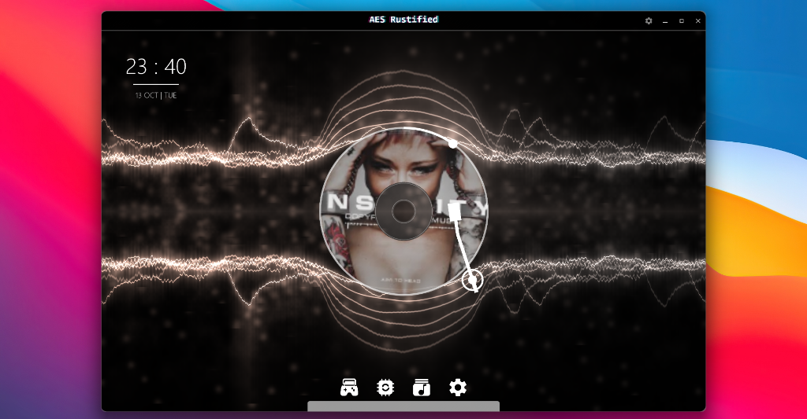

# AES - Rustified

**AES Rustified is a Rust/egui port of [AES_Lacrima](https://github.com/aruantec/AES_Lacrima).**

AES stands for **"Aruan's Entertainment Software"**, formerly known as **@ES** in a small emulation
community. AES_Lacrima is a personal research project, emulation frontend and multimedia app
created with the Avalonia UI framework — this port brings it to Rust with
[egui](https://github.com/emilk/egui). It's by no means the perfect project, but it helps me learn
how to use the framework.

This port focuses on the multimedia side: a cover-flow carousel and card grids for the music
library, local folder scanning, online media playback (YouTube and friends via yt-dlp), playlist
import/export, a metadata editor, an equalizer, and the spectrum-driven shader backgrounds.

Supports Plasma6 Wallpaper (Shadertoy/Fragment) Shaders in the same loose uniform convention as
Lacrima (`iResolution`, `iTime`, `iChannel0` spectrum, `iChannel1` cover) — GLSL is translated to
WGSL at runtime via naga. The bundled collection lives in `shaders/shadertoys`.
 [https://github.com/y4my4my4m/kde-shader-wallpaper](https://github.com/y4my4my4m/kde-shader-wallpaper/tree/master/package/contents/ui/Shaders) 

Some of the included shaders react to the music by using the player's spectrum data (`iChannel0`
is fed a 512-wide spectrum texture every frame).

## Screenshots

## Controls

### Global

| Key | Function |
|---|---|
| `F12` | Toggle fullscreen — entering is instant, exiting shows a confirmation prompt |
| `Esc` | Layered back-out: close prompt → close search → exit game-fullscreen → stop emulator → fullscreen prompt → navigate back |
| `Backspace` | Back navigation |
| `Ctrl+F` | Focus search (album filter, item search, or the emulation pill) |
| `Ctrl+R` | Cycle repeat mode (Off → All → One) |
| Media keys | `⏯` play/pause · `⏹` stop · `⏭`/`⏮` next/previous track — active while the window is focused |

### Music view

| Key | Function |
|---|---|
| `←` `→` `↑` `↓` | Navigate the card grid / album strip |
| `Shift` + arrows | Reorder the selection (cards or albums) |
| `Ctrl+A` | Select all in the owning list |
| `Delete` | Delete the selection (with confirmation) |
| `Tab` | Cycle keyboard ownership between the album strip and the card grid |
| `Enter` | Activate like a double-click — open the album / play the track |
| `Alt` (clean tap) | Cycle the cover layout (carousel → vertical → horizontal) |
| `Ctrl` + `↑`/`↓` | Volume ±5% |
| `Ctrl` + `←`/`→` | Seek ∓5s / ±5s |
| `1`–`9` | Activate the numbered main-menu entries (Main view only) |

### Emulation view

| Key | Function |
|---|---|
| `←` `→` `↑` `↓` | Navigate the ROM card grid |
| `Ctrl+A` | Select all ROMs |
| `Delete` | Delete selected ROMs (with confirmation) |
| `Enter` | Launch the selected ROM — or return to the running game's capture |
| `Esc` | Exit game-fullscreen → stop the emulator on the next press |
| Double-click on capture | Toggle game-fullscreen (capture covers the whole screen) |

### Dialogs & widgets

| Key | Function |
|---|---|
| `Tab` / arrows | Move focus between dialog buttons |
| `Enter` | Run the focused dialog button |
| `Esc` | Close overlays and prompts (settings, tag editor, ROM editor, patches, custom config) |
| Arrows on a focused slider | Nudge the value (`Shift` = ×10 step) |

Text fields capture their own keys while focused — no shortcuts fire while typing.

## Build

- Compile: `cargo build --release`
- Binary: `target/release/AES-Rustified.exe`

Optional: **yt-dlp** for online media — manage it from *Settings → Libraries* and the app
downloads it into `%LOCALAPPDATA%\AES_Rustified\Tools` automatically (no PATH needed).

App data (settings, metadata/cover caches, stream cache, tools) lives under
`%LOCALAPPDATA%\AES_Rustified`.
